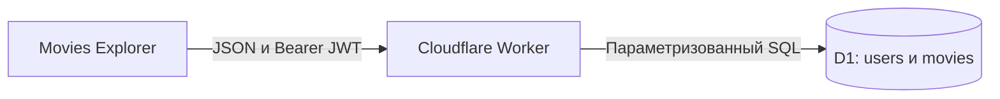

<div align="center">

# 🎞️ Movies Explorer API

**REST API личных коллекций. Учётные записи и выбранные фильмы хранятся в Cloudflare D1.**

  

[Приложение](https://goldlexx.github.io/movies-explorer-frontend/) · [Клиент](https://github.com/goldlexx/movies-explorer-frontend) · [Маршруты](#маршруты)

</div>

Клиент поставляет демонстрационный каталог самостоятельно. Этот сервис отвечает за регистрацию, выдачу JWT, профиль и список сохранённых фильмов каждого пользователя. Базовый адрес опубликованного API — `https://movies-explorer-api.rustik-yuldashev.workers.dev`.



## Маршруты

| Метод и путь | Назначение |
| --- | --- |
| `POST /signup` | Создать пользователя по имени, email и паролю |
| `POST /signin` | Войти по email и паролю, получить объект с полем `token` |
| `GET /users/me`, `PATCH /users/me` | Прочитать или изменить имя и email текущего пользователя |
| `GET /movies`, `POST /movies` | Прочитать личный список или добавить фильм |
| `DELETE /movies/:_id` | Удалить свою запись по её идентификатору в D1 |

После входа клиент передаёт `Authorization: Bearer <JWT>`. Поле `movieId` связывает запись с фильмом каталога, а `_id` идентифицирует сохранённую запись. Пользователь определяется по подписи JWT. Владелец фильма задаётся сервером.

**Пример чтения своего списка в локальном окружении** (shell с переменной `TOKEN`, содержащей JWT тестовой учётной записи)

```sh
curl -H "Authorization: Bearer $TOKEN" http://localhost:8787/movies
```

До первого сохранения корректный ответ — `200 OK` и JSON-массив `[]`. Без авторизации тот же маршрут возвращает `401` с полем `message`.

## Хранение и доступ

| Технология | Что делает в проекте |
| --- | --- |
| Cloudflare Workers | Маршрутизация и JSON-ответы в [app.js](app.js) |
| D1 и SQL | Таблицы пользователей и фильмов, уникальный email без учёта регистра, внешний ключ владельца |
| Web Crypto | PBKDF2 с индивидуальной солью для паролей, HS256 для подписи JWT |
| CORS | Браузерный доступ к API с https://goldlexx.github.io |

## Локальная разработка

Установите зависимости командой `npm ci`. Создайте `.dev.vars` по [примеру](.dev.vars.example) и задайте `JWT_SECRET` длиной не менее 32 символов для своего локального окружения. Binding `DB` описан в [wrangler.jsonc](wrangler.jsonc).

```sh
npm run db:migrate:local
npm run dev
```

Wrangler применяет [миграции](migrations/) к локальной D1. Для ручной проверки используйте адрес, выведенный Wrangler, создайте тестовую учётную запись, выполните вход и запросите личный список. В проекте нет отдельного скрипта `npm test`. Секрет опубликованного сервиса хранится в Cloudflare.

В манифесте проекта указана лицензия ISC. [package.json](package.json)
